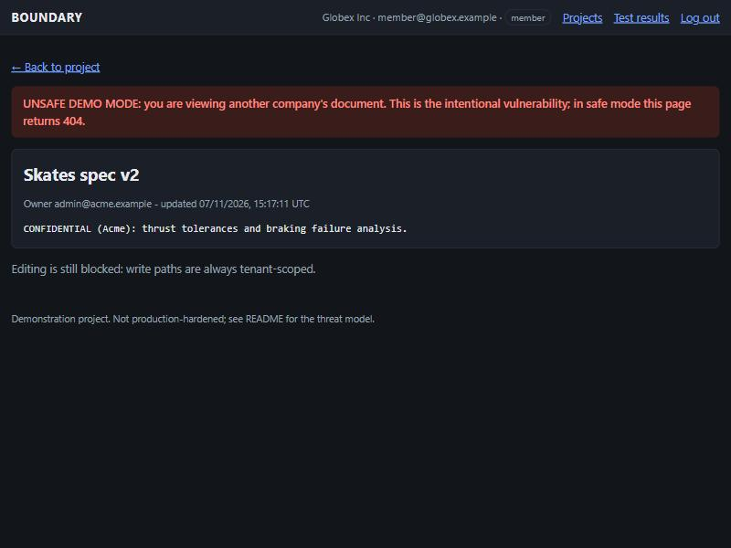
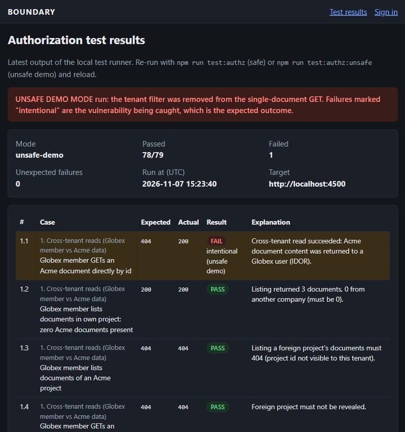

# Demo: break, detect, fix, pass

A short, reproducible walkthrough of BOUNDARY's **local-only** vulnerability demo: remove the tenant filter from one query, watch the authorization test runner catch it specifically, then restore it and watch every check pass again. This is the same demo described in the README's [Vulnerability demo](../README.md#vulnerability-demo-break-detect-fix-pass) section, written here as a standalone, step-by-step script with exact commands and expected output, so it can be followed (or recorded) on its own.

**What this proves:** a single missing `AND company_id = $2` is the most common real-world multi-tenant bug (broken object-level authorization / IDOR). The test runner doesn't just "find a bug" -- it fails on exactly one of 79 cases, names it as the intentional one, and every other control (writes, role checks, listings, the new admin-audit and request-id checks) keeps passing. That's the difference between "we broke the app" and "we proved the detection is specific."

---

## Prerequisites

- Node.js 22.18+, Docker, and this repo checked out.
- `npm install` already run.
- `cp .env.example .env` (once, if you haven't).

Two terminals: **A** runs the server, **B** runs commands against it.

---

## 0. Baseline: safe server, everything passes

**Terminal A:**

```bash
npm run db:up                 # Postgres on localhost:5440, if not already running
npm run db:migrate
npm run db:seed
npm run dev                   # http://localhost:3000
```

**Terminal B:**

```bash
npm run test:authz
```

Expected: `[runner] 79/79 passed, 0 failed (0 intentional). Results: test-results.json`, exit code `0`.

Open <http://localhost:3000/results> -- every row is green.

---

## 1. BREAK: restart the server in unsafe demo mode

**Terminal A:** stop the server (Ctrl+C), then:

```bash
npm run dev:unsafe
```

You'll see a warning banner in the server log (`*** BOUNDARY UNSAFE DEMO MODE ***`). This sets `BOUNDARY_UNSAFE_DEMO_MODE=1` and `BOUNDARY_ALLOW_UNSAFE=local-demo-only` for **this process only** -- nothing is written to `.env`, and the toggle refuses to activate at all under `NODE_ENV=production` or on a non-localhost `Host` header (see `src/lib/unsafe-demo.ts`).

**Show it by hand** (optional, but this is the part worth recording):

1. Log in at <http://localhost:3000/login> as `member@globex.example` / `Password123!`.
2. Open <http://localhost:3000/documents/a0000000-0000-4000-8000-000000000201> directly.
3. Acme Corp's "Skates spec v2" document renders, with a red **UNSAFE DEMO MODE** banner, to a Globex user. In safe mode this id returns 404.



---

## 2. DETECT: the runner catches it, and only it

**Terminal B:**

```bash
npm run test:authz:unsafe
```

Expected: a banner reading `UNSAFE DEMO RESULT: vulnerability DETECTED as designed`, **exactly one** failure (case `1.1`, marked `intentional (unsafe demo)`), `78/79 passed`, exit code `1`.

```
[runner] 78/79 passed, 1 failed (1 intentional). Results: test-results.json
```

Open <http://localhost:3000/results> -- case 1.1 is highlighted as the intentional failure; every other case, including the admin-audit-log group and the request-correlation-id group added in this change, still passes.



**Also worth showing:** running the *safe*-mode command against this same unsafe server refuses outright:

```bash
npm run test:authz
```

```
[runner] ERROR: Server reports unsafe demo mode ON. Re-run with --unsafe-demo (npm run test:authz:unsafe), or restart the server normally.
```

Exit code `2`. The runner will not silently grade an unsafe server as if it were safe -- that's a deliberate guard, not a missing check.

---

## 3. FIX: restart normally

**Terminal A:** stop the server (Ctrl+C), then:

```bash
npm run dev
```

No unsafe env vars, no banner. The toggle is off again.

---

## 4. PASS

**Terminal B:**

```bash
npm run test:authz
```

Expected: back to `[runner] 79/79 passed, 0 failed (0 intentional)`, exit code `0`. Reload <http://localhost:3000/results>: all green again.

---

## Recording checklist

A real screen recording of this walkthrough was **not** captured as part of this change -- the two screenshots above (the live leak, and the unsafe-mode results page) were captured locally during verification and are genuine, current output, but they are stills, not a video or GIF. If you want a recording:

- [ ] Use a real screen recorder (OS-native: Windows Game Bar / `Win+G`, macOS `Cmd+Shift+5`, or a terminal-only tool like `asciinema` if you only want the command output, not the browser).
- [ ] Record **two terminals side by side** (server log on one side, commands/output on the other) so the "big red warning banner on startup" and the "exactly one failure" output are both visible without cutting away.
- [ ] Follow steps 0-4 above in order, narrating or captioning each step number.
- [ ] Keep the browser steps in section 1 (logging in as the Globex member, opening the Acme document url) -- that's the moment that makes the vulnerability concrete instead of abstract.
- [ ] Stop recording after step 4's green `79/79`, not before -- the "fix" has to be shown working, not just claimed.
- [ ] Trim dead time around `npm install`/server-boot waits; keep the actual demo under ~3 minutes, matching the README's estimate.
- [ ] Re-run `npm run db:seed` after recording if you created/modified any data while narrating, so the repo's demo accounts are back to their seeded state for the next person.
- [ ] Save the recording outside this repo (or in a path that's `.gitignore`d) unless you intend to commit it -- a video file shouldn't be added to the repo without a deliberate decision about size and whether a hosted link is more appropriate.
